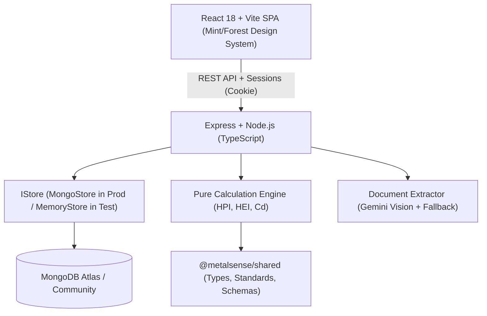

# MetalSense — Heavy Metal Pollution Intelligence SaaS

[](https://www.typescriptlang.org/)
[](https://react.dev/)
[](https://tailwindcss.com/)
[](https://expressjs.com/)
[](https://archive.org/details/gov.in.is.10500.2012)
[](https://www.docker.com/)
[](tests/)

**MetalSense** is a production-grade environmental intelligence SaaS platform for assessing heavy metal pollution in groundwater and drinking water from laboratory reports and measured field data. It computes peer-reviewed pollution indices (HPI, HEI, $C_d$) deterministically, validates analytical detection limits ($<\text{LOD}$), compares concentrations against versioned statutory standards (BIS IS 10500:2012, WHO Guidelines), visualizes contamination hotspots across monitored aquifers, and exports auditable PDF compliance dossiers and CSV matrices.

---

## Quick Start (5 Lines)

```bash
cp .env.example .env                  # 1. Setup environment template
npm install                           # 2. Install workspace dependencies
npm run build                         # 3. Build shared, server, and client bundles
npm test                              # 4. Run test suite (57 tests passing)
npm run dev                           # 5. Launch both server (:5000) and client (:5173)
```

> Open `http://localhost:5173` in your browser. Register an account, create a workspace, and click **"Download template"** or upload a test dataset from `examples/` (`examples/example_lab_results.csv` or `examples/groundwater_lab_samples.csv`).

---

## 1. Scientific Integrity Mandate

> **Core Scientific Rule:** MetalSense strictly separates deterministic numerical calculation from generative AI. Pollution indices ($HPI$, $HEI$, $C_d$) are evaluated exclusively by pure, versioned, unit-tested TypeScript functions using documented formulas and statutory standard limits. Generative AI is strictly restricted to candidate OCR extraction proposals and structured natural-language summaries. No neural network or LLM performs arithmetic, declares water potable, or generates medical health diagnoses.

---

## 2. Key Capabilities

1. **Deterministic Scientific Calculation Engine (`v1.1.0-deterministic`)**
   - **Heavy Metal Pollution Index (HPI):** Mohan et al. (1996), Prasad & Bose (2001) with intermediate sub-index traces ($W_i, Q_i, W_i \cdot Q_i$).
   - **Heavy Metal Evaluation Index (HEI):** Edet & Offiong (2002) evaluating cumulative toxic ratios against maximum admissible concentrations ($H_c / H_{mac}$).
   - **Degree of Contamination ($C_d$):** Backman et al. (1998) calculating cumulative contamination factors ($C_{fi} = \frac{C_{Ai}}{C_{Ni}} - 1$) using upper permissible concentrations ($S_i$).
   - **Detection Limit ($\text{LOD}$) Handling:** Supports EPA $0.5 \times \text{LOD}$ substitution, zero substitution, or conservative full $\text{LOD}$. Exceedance flags respect effective LOD values.

2. **Official Regulatory Standards Registry**
   - **BIS IS 10500:2012:** Indian Standard Drinking Water Specification (including 2015 amendments).
   - **WHO GDWQ 4th Edition:** World Health Organization Guidelines for Drinking-water Quality (2022).
   - Real-time statutory re-evaluation creating immutable `AnalysisRun` audit records.

3. **Multi-Modal Data Ingestion & 3-Step CSV Workflow**
   - **Step 1:** Upload CSV or choose from test datasets (`examples/groundwater_lab_samples.csv`).
   - **Step 2:** Pre-commit preview validating rows, mapped column headers, and GPS coordinates without saving.
   - **Step 3:** Commit and recalculate indices across all valid samples.
   - Multimodal OCR proposal pipeline for scanned PDF/image certificates with mandatory human verification before saving.

4. **Geospatial & Analytical Dashboards**
   - Interactive OpenStreetMap/Leaflet visualization coloring monitoring wells by calculated HPI category ($<25$ Safe, $25-99$ Moderate, $\ge 100$ Critical).
   - Responsive Recharts bar charts comparing measured concentrations against standard permissible limits.
   - Honest empty states for unmapped samples (never guesses GPS coordinates).

5. **Auditable Compliance Dossiers**
   - High-resolution PDF export with mathematical snapshot, weights, calculation version (`v1.1.0-deterministic`), and regulatory disclaimers.
   - RFC-4180 compliant CSV matrix export for research, GIS, and statistical pipelines.

---

## 3. Architecture & Monorepo Structure



```
NSP/
├── shared/              # Isomorphic domain models, Zod schemas, standards registry, unit converters
│   ├── src/types/       # Canonical types (Sample, AnalyteMeasurement, RegulatoryStandard, AnalysisRun)
│   ├── src/constants/   # BIS 10500:2012 and WHO GDWQ 4th Edition specifications
│   └── src/utils/       # Unit normalization helpers (ug/L, mg/L, ppm, ppb)
│
├── server/              # Node.js + Express + TypeScript API
│   ├── src/services/    # Calculation engine, AI explainer, CSV parser, report generator (PDF/CSV)
│   ├── src/routes/      # Auth, workspaces, projects, samples, analyses, standards, reports, imports
│   ├── src/middleware/  # Google OAuth, session cookies, RBAC, 10MB upload limits, request IDs
│   ├── src/db/          # Mongoose models, MongoStore, MemoryStore (zero seed data)
│   └── tests/           # Vitest integration & unit test suite (51 passing tests)
│
├── client/              # React 18 + Vite + TypeScript + Tailwind CSS SPA
│   ├── src/features/    # Landing, Dashboard, Samples, Analytics, Map, Reports, Methodology, Settings, Auth
│   ├── src/components/  # Accessible UI primitives (Button, Card, Badge, StatusBadge, Alert, Math)
│   └── src/lib/         # api.ts (TanStack Query hooks), motion.ts (Framer Motion animations)
│
├── examples/            # Tested, realistic environmental groundwater datasets
│   ├── groundwater_lab_samples.csv  # 10 monitoring wells across Indian industrial & agricultural basins
│   └── example_lab_results.csv      # Baseline test matrix with diverse metal profiles
│
├── docs/                # Engineering specifications & guides
│   ├── DEMO_SCRIPT.md           # 3-minute evaluation walkthrough
│   ├── architecture.md          # Multi-tenant system architecture & design tokens
│   ├── scientific-methodology.md# Mathematical formulations and derivation proofs
│   ├── security-and-privacy.md  # RBAC, OAuth 2.0, prompt injection defense, and sanitization
│   ├── testing.md               # Quality assurance, test commands, and invariant proofs
│   └── deployment.md            # Production Docker, Nginx reverse proxy, and monitoring
│
├── Dockerfile           # Multi-stage production container build
├── docker-compose.yml   # Multi-service production orchestration (App + MongoDB 7)
├── package.json         # Workspaces root definition
└── .env.example         # Documented environment template with placeholders
```

---

## 4. Environment Variables

Create `.env` in the project root:

| Variable | Description | Default / Example |
|---|---|---|
| `NODE_ENV` | Runtime environment (`development`, `test`, `production`) | `development` |
| `PORT` | API server listen port | `5000` |
| `SESSION_SECRET` | Secret key for signing session tokens (min 32 chars) | Random 64-char hex string |
| `MONGODB_URI` | MongoDB connection URI | `mongodb://localhost:27017/metalsense` |
| `CLIENT_ORIGIN` | Frontend URL for CORS | `http://localhost:5173` |
| `GOOGLE_CLIENT_ID` | Google OAuth 2.0 Web Client ID | `your-google-client-id.apps.googleusercontent.com` |
| `GEMINI_API_KEY` | Optional Google AI API key for document OCR proposals | `your-gemini-api-key` |
| `GEMINI_MODEL` | Gemini vision model for document extraction | `gemini-2.5-flash` |

---

## 5. Verification & Testing

The repository maintains 100% test pass rates across all mathematical and integration suites:

```bash
# Run TypeScript compilation check across all 3 workspaces
npm run typecheck

# Run test suite across server and client (55 passed)
npm test

# Build production bundles
npm run build
```

---

## 6. Peer-Reviewed Citations

- **Mohan, S. V., Nithila, P., & Reddy, S. J. (1996).** Estimation of heavy metal in drinking water and development of heavy metal pollution index. *Journal of Environmental Science & Health Part A*, 31(2), 283–289.
- **Prasad, B., & Bose, J. M. (2001).** Evaluation of the heavy metal pollution index for ground water of an active mining area. *Environmental Monitoring and Assessment*, 68(3), 273–283.
- **Edet, A. E., & Offiong, O. E. (2002).** Evaluation of water quality pollution indices for heavy metal contamination monitoring. A study case from Akpabuyo-Odukpani area, Lower Cross River Basin (southeastern Nigeria). *GeoJournal*, 57(4), 295–304.
- **Backman, B., Bodiš, D., Lahermo, P., Rapant, S., & Tarvainen, T. (1998).** Application of a summary environmental index in evaluating water quality. *Environmental Geology*, 36(1-2), 107–113.
- **Bureau of Indian Standards (BIS).** IS 10500: 2012 Drinking Water — Specification (Second Revision). New Delhi: BIS, 2012.
- **World Health Organization (WHO).** Guidelines for Drinking-water Quality: Fourth Edition Incorporating the First and Second Addenda. Geneva: WHO, 2022.
