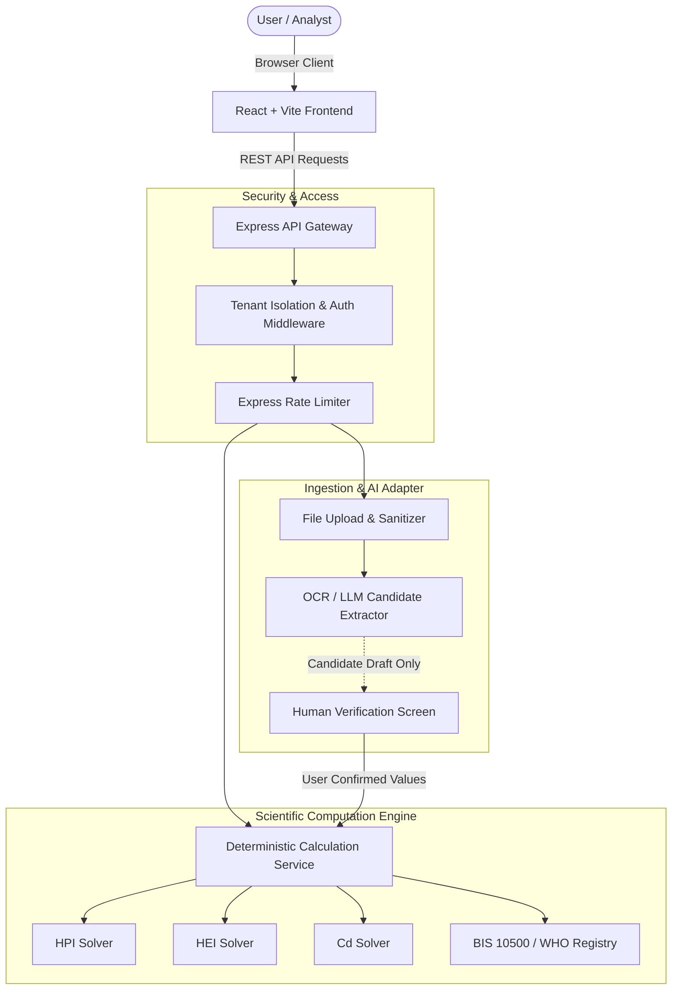

# MetalSense Architecture & System Design

## 1. Architectural Philosophy
MetalSense is designed as a modular, TypeScript-first environmental intelligence platform. The architecture cleanly separates untrusted candidate document extraction from deterministic mathematical calculations.

## 2. Workspaces Layout
- `shared/`: Isomorphic types, Zod schemas, unit conversion formulas, and standard registries.
- `server/`: Express backend, deterministic calculation services, API routes, middleware.
- `client/`: React 18, Vite, Tailwind CSS, shadcn-inspired primitives, Recharts, Leaflet.

## 3. Security Principles
- All API payloads are validated with Zod at runtime.
- Multi-tenant isolation: requests are scoped to workspace permissions.
- Untrusted file uploads are scrubbed, MIME-checked, and stored under randomized UUIDs.
- Secrets reside exclusively in server-side environment variables.
